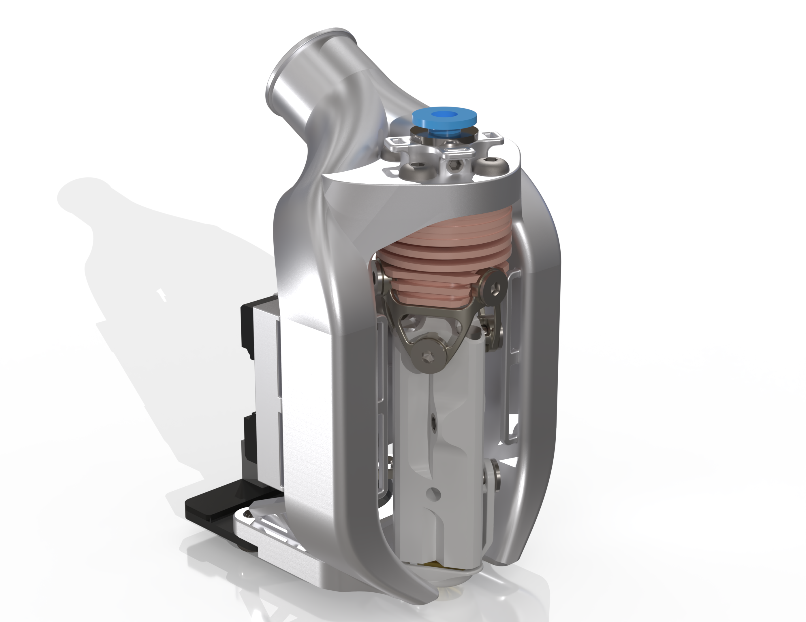
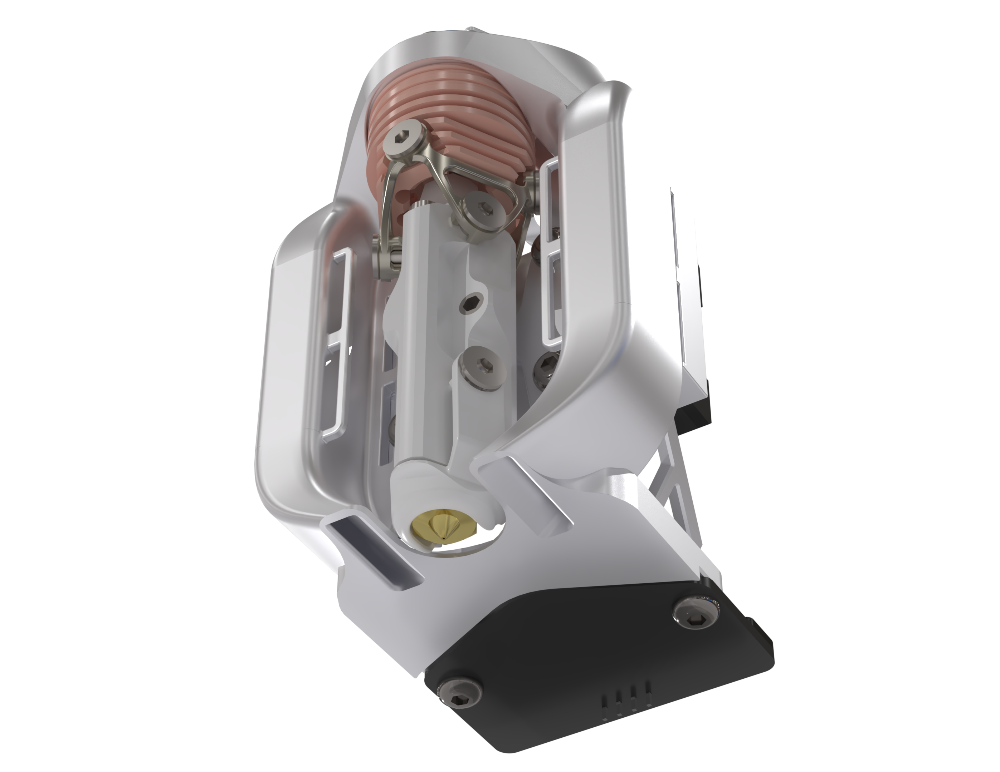
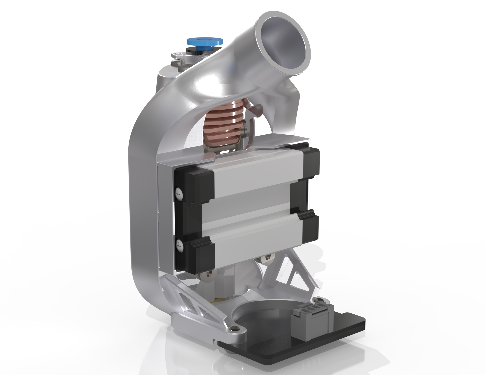
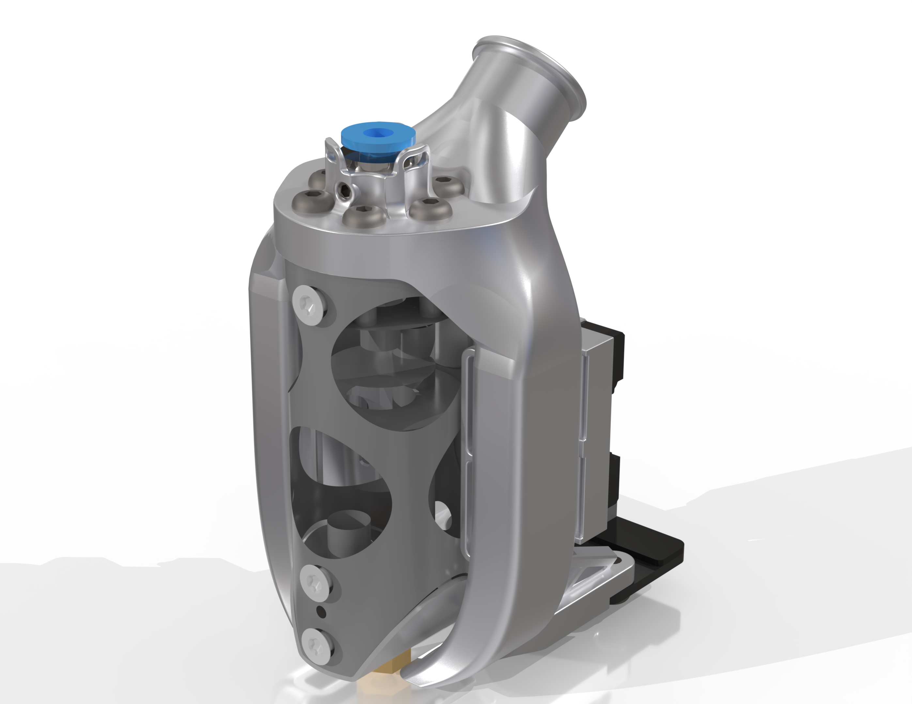
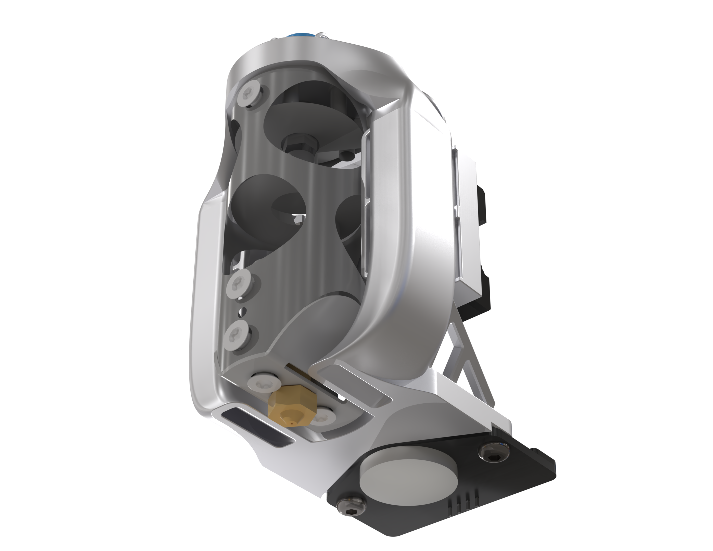
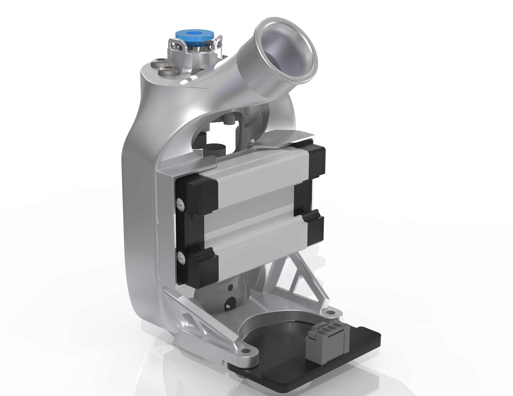

# Microwaved Bowden Toolhead

This is an SLM toolhead designed for Chube and Tricorn hotends.

## Features
- Support for Chube and Tricorn hotends
- Bowden extrusion
- Mounting points for a kevlar sheath
- Tricorn bottom bracing
- Custom Tricorn sheild
- CPAP part cooling
- Pull-through belt routing
- Center of mass between the belts

## Requirements

- Tricorn or Chube
- Monolith SLM belt clamp
- Beacon H probe
- 16mm CPAP tube
- ECAS fitting (4mm tube)
- Monolith belt spacing
- Bowden extruder
- Kevlar sheath (optional)
- M3 tap for aluminium

## Acknowledgements

Thanks to:

CloakedWayne for his SLM belt clamp

Colphaer for his boombox, kevlar sheathing 
and advice on bowden fittings

Solar and Diode King for test fitting
and feedback 

Anyone else who gave advice 
along the way.
